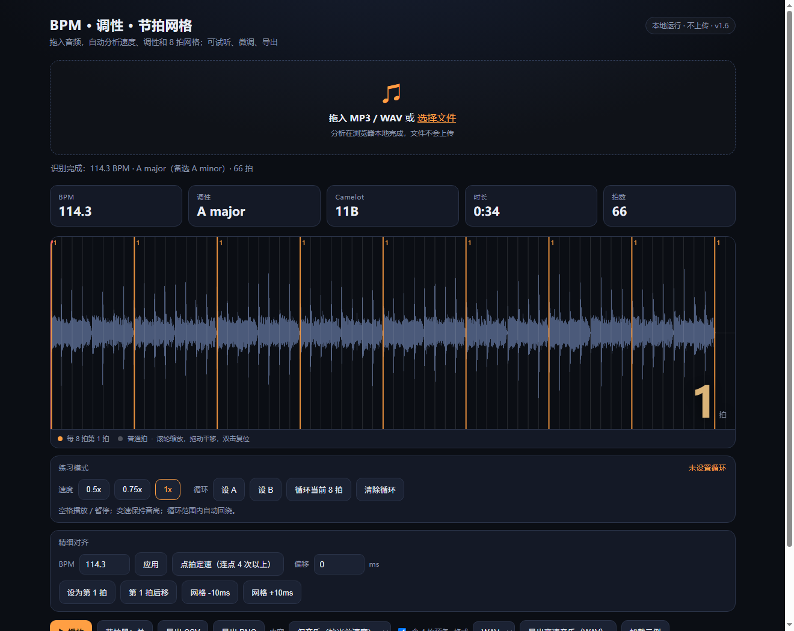

# BPM · 调性 · 节拍网格

> 一个完全在浏览器本地运行的 DJ / 练舞辅助小工具：拖入音频，自动分析 **BPM、调性（含 Camelot）和 8 拍网格**，可变速试听、循环练习、手动微调对齐，并导出节拍网格或变速音频。



- 无需安装、无需账号、**文件不会上传**（全部在浏览器本地完成）
- 单文件网页应用（`index.html` 内嵌全部逻辑），下载即用

## 在线使用

仓库目前是**私有预览**状态（示例音频版权待确认后才会公开），暂未开启 GitHub Pages；
公开后会在此处补充在线地址。

## 本地使用

```bash
# 方式一：放在本地静态服务器上（推荐，示例按钮可用）
python -m http.server 8000
# 然后浏览器打开 http://127.0.0.1:8000/

# 方式二：直接双击 index.html（拖入文件可用；"加载示例"受浏览器 file:// 限制不可用）
```

## 功能

| 功能 | 说明 |
|---|---|
| 自动 BPM | 拖入音频自动估算速度，可手动输入或连点定速修正 |
| 调性识别 | 识别调性并给出 Camelot 编号；同时提示关系小调/大调备选 |
| 8 拍网格 | 波形上标注节拍线，每 8 拍第 1 拍高亮，方便数拍与对点 |
| 波形交互 | 滚轮缩放、拖动平移、双击复位 |
| 变速不变调 | 0.5x / 0.75x / 1x 试听，SoundTouch 时间伸缩 |
| 循环练习 | 设 A / 设 B、A-B 循环、循环当前 8 拍、空格播放/暂停 |
| 精细对齐 | 手动 BPM、点拍定速、偏移（ms）、设为第 1 拍、网格 ±10 ms |
| 节拍器 | 可开关的点击轨 |
| 导出 | 节拍网格 CSV、波形 PNG、变速音频（WAV / MP3；仅音乐 / 音乐+节拍 / 仅节拍；可含 4 拍预备） |
| 示例音频 | 一键加载同目录的 `demo.wav`（34 秒节奏示例；本仓库暂未包含，见下方说明） |

> **关于 demo.wav：** 内置示例音频暂未纳入本仓库（版权确认中）。如需使用"加载示例"按钮，
> 请把 `demo.wav` 放在 `index.html` 同目录；或者直接拖入自己的音频文件，其他功能不受影响。

> BPM / 调性均为**估算值**，会受混音、半速/倍速、调式关系影响；正式使用请以 Serato / Mixed In Key 等 DJ 软件结果为准。

## 隐私与安全

这个工具刻意做成"零上传"：

- ✅ **所有音频解码与分析都在浏览器本地完成**，不会上传任何文件
- ✅ **无网络请求**：页面不加载任何第三方 CDN / 字体 / 统计脚本；唯一的资源请求是加载同目录的 `demo.wav`
- ✅ **无遥测、无统计、无账号、无 Cookie、无 localStorage / IndexedDB**
- ✅ 代码中没有 API key、token、密码或任何个人信息
- ✅ 不申请麦克风、定位、通知等浏览器权限

## 技术实现

- **Web Audio API**：音频解码、播放、变速（配合 SoundTouch）
- **BPM 估算**：能量包络 + 自相关节拍检测
- **调性识别**：chroma 特征匹配大调/小调模板
- **波形与网格**：Canvas 绘制，支持缩放/平移/双击复位
- **导出**：CSV / PNG / WAV（原生编码）/ MP3（lamejs 编码）
- **变速不变调**：SoundTouch JS 时间伸缩

整个应用是单个 `index.html`（约 2500 行），无构建步骤，改完刷新即可。

## 浏览器兼容

现代 Chrome / Edge / Firefox / Safari（需要 Web Audio API 与 Canvas）。移动端浏览器可打开，但窄屏体验有限。

## 第三方组件

| 组件 | 版本 | 许可证 | 用途 |
|---|---|---|---|
| [lamejs](https://github.com/zhuker/lamejs) | 1.2.1 | LGPL-3.0 | 浏览器端 MP3 编码 |
| [SoundTouch JS](https://github.com/cutterbl/SoundTouchJS) | 0.3.0 | LGPL-2.1-or-later | 变速不变调 |

以上两个库**内嵌在 `index.html` 中**，其版权与许可证归原作者所有，完整许可证文本见 [`licenses/`](licenses/) 与 [`THIRD_PARTY_NOTICES.md`](THIRD_PARTY_NOTICES.md)。

## 许可证

本项目自身代码采用 **MIT License**（见 [LICENSE](LICENSE)）。
内嵌的第三方库仍遵循各自的 LGPL 许可证，不会因为本项目的 MIT 许可而改变。

## 贡献

欢迎提 Issue / PR。因为应用是单文件、无构建，改动后请用 Chrome/Edge 打开验证一下再提交。

## 免责声明

本项目为个人的 DJ 练习辅助工具，与 Serato、Mixed In Key、Pioneer 等任何商业软件/硬件公司无关。BPM 与调性结果仅供参考。
